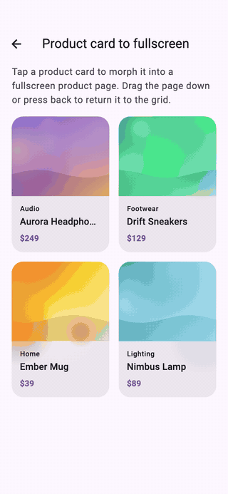
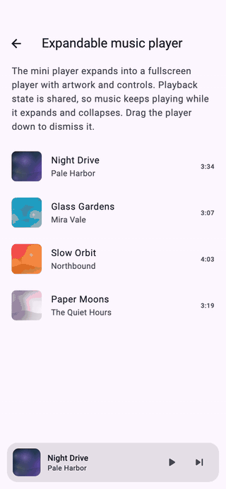
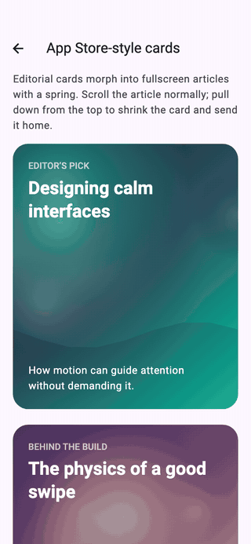
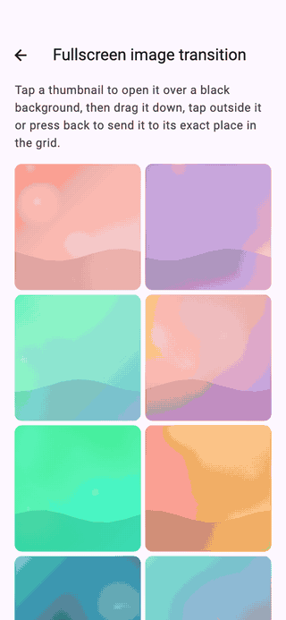
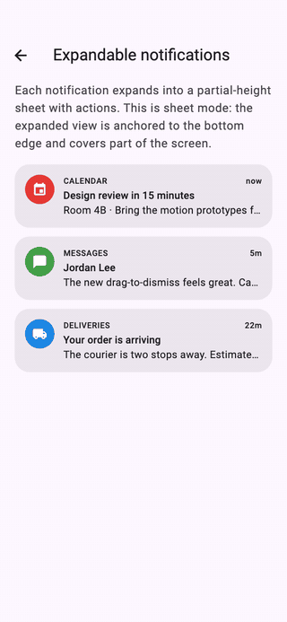

# Expandable Animation — Flutter Widget to Fullscreen Animations

**Expand any widget. Animate every transition.**

[](https://pub.dev/packages/expandable_animation)
[](https://github.com/boffincoders/expandable_animation/actions/workflows/ci.yml)
[](LICENSE)

Expandable Animation is a Flutter package for **widget-to-fullscreen
transitions**, **expandable card animations** and interactive **container
morphing**. Wrap any widget, give it an expanded view, and the package morphs
its position, size, corner radius and color into a fullscreen page, a dialog
or a bottom sheet — with spring physics, drag-to-dismiss and a smooth reverse
animation back into place.

It is not an accordion or an `ExpansionTile` replacement: it turns a widget
into a separate, larger experience, like the cards in an app store, a mini
music player or a photo thumbnail.

**[Live demo](https://boffincoders.github.io/expandable_animation/demo/)** ·
**[Documentation](https://boffincoders.github.io/expandable_animation/)** ·
**[API reference](https://pub.dev/documentation/expandable_animation/latest/)**

<p align="center">
  
  
  
</p>
<p align="center">
  
  
</p>

The animations above are rendered frame by frame from the [example app](example/)
with `./scripts/record_media.sh`.

## Why use Expandable Animation?

Building a card-to-fullscreen transition by hand usually means combining a
custom `PageRoute`, `Hero` widgets, measured `RenderBox` bounds, a gesture
recognizer for dismissal and scroll coordination. This package packages that
into one wrapper:

- **One widget.** Wrap the collapsed widget, return the expanded widget from a
  builder. No `Hero` tags, no route classes.
- **Interactive dismissal.** Drag the expanded view down to shrink it and send
  it home; scrollable content keeps scrolling until it reaches its top.
- **Interruptible.** Tap again, press back or call the controller in the middle
  of a transition and it reverses from where it is.
- **Real navigation.** The expanded view is a modal route, so the back button,
  Escape, `PopScope`, focus and screen readers work as users expect.
- **Zero dependencies.** Only the Flutter SDK.

## Features

- Widget-to-fullscreen, dialog (centered panel) and sheet (partial height)
  expansion, plus custom bounds
- Smooth, reversible container transform: position, size, border radius and
  surface color
- Duration and curve, or spring physics with optional overshoot
- Background scrim with configurable color, opacity and optional blur
- Drag-to-dismiss with distance and velocity thresholds, spring settle-back,
  haptic feedback and scroll coordination
- A flick hands its speed to the collapse, so fast flicks close faster
- `ExpandableAnimationZoomable`: pinch, pan and double-tap zoom that cooperate
  with drag-to-dismiss
- `ExpandableAnimationController`: `expand()`, `collapse()`, `toggle()`,
  `phase`, `progress`, `isDragging`
- Lifecycle callbacks: `onExpanded`, `onCollapsed`, `onPhaseChanged`
- Back button, Escape key, `PopScope` vetoes and semantics dismiss action
- Keyboard activation (Enter/Space) and screen-reader labels
- Reduced-motion support
- Re-measures the source on collapse; fades out gracefully if the source is
  gone
- Works with `MaterialApp`, `CupertinoApp` and `WidgetsApp`; inherited themes
  are carried into the expanded view

## Installation

```bash
flutter pub add expandable_animation
```

```dart
import 'package:expandable_animation/expandable_animation.dart';
```

## Quick start

```dart
ExpandableAnimation(
  borderRadius: BorderRadius.circular(20),
  expandedBuilder: (context) => const ProductDetails(),
  child: const ProductCard(),
)
```

Tap the card and it morphs into `ProductDetails`. Drag down, press back or
call `Navigator.pop(context)` to collapse it.

## Basic usage

Give the surface colors that match your widgets so the morph looks seamless:

```dart
ExpandableAnimation(
  borderRadius: BorderRadius.circular(20),
  collapsedColor: Theme.of(context).colorScheme.surfaceContainerHigh,
  expandedColor: Theme.of(context).colorScheme.surface,
  expandedBuilder: (context) => ProductDetails(product: product),
  child: ProductCard(product: product),
)
```

Close the expanded view from inside it:

```dart
IconButton(
  icon: const Icon(Icons.close),
  onPressed: () => ExpandableAnimation.of(context).collapse(),
)
```

## Advanced usage

```dart
ExpandableAnimation(
  controller: controller,
  mode: const ExpandableAnimationMode.dialog(maxSize: Size(480, 640)),
  physics: ExpandableAnimationPhysics.bouncy,
  borderRadius: BorderRadius.circular(24),
  expandedBorderRadius: BorderRadius.circular(32),
  backgroundBlur: 10,
  backgroundOpacity: 0.3,
  gestureConfig: const ExpandableAnimationGestureConfig(
    dismissThreshold: 0.15,
    velocityThreshold: 600,
  ),
  onExpanded: () => debugPrint('expanded'),
  onCollapsed: () => debugPrint('collapsed'),
  expandedBuilder: (context) => const ProfileDetails(),
  child: const ProfileTile(),
)
```

### Expansion modes

| Mode | Result |
| --- | --- |
| `ExpandableAnimationMode.fullscreen()` | Fills the screen (default). `useSafeArea: true` stops at the insets. |
| `ExpandableAnimationMode.dialog()` | Centered panel with a margin and maximum size; stays above the keyboard. |
| `ExpandableAnimationMode.sheet(heightFactor: 0.6)` | Bottom-anchored partial expansion; rides on top of the keyboard. |
| `ExpandableAnimationMode.custom(resolver)` | Any rectangle you compute from the screen size, safe area and source bounds. |

## Controller usage

```dart
class _ProductTileState extends State<ProductTile> {
  final controller = ExpandableAnimationController();

  @override
  void dispose() {
    controller.dispose();
    super.dispose();
  }

  @override
  Widget build(BuildContext context) {
    return ExpandableAnimation(
      controller: controller,
      expandOnTap: false, // expand only from code
      expandedBuilder: (context) => const ProductDetails(),
      child: const ProductCard(),
    );
  }
}

await controller.expand();   // completes when expanded (or interrupted)
await controller.collapse();
controller.toggle();

controller.phase;      // collapsed, expanding, expanded, collapsing
controller.progress;   // 0.0 – 1.0
controller.isDragging; // true while the user drags to dismiss
```

The controller is a `ChangeNotifier`, so it can drive a `ListenableBuilder`.
Calling `collapse()` during an expansion (or `expand()` during a collapse)
reverses the transition from its current position.

## Gesture configuration

```dart
ExpandableAnimation(
  enableDragToDismiss: true, // default
  gestureConfig: const ExpandableAnimationGestureConfig(
    dismissThreshold: 0.2,         // fraction of the expanded height
    velocityThreshold: 700,        // px/s; a fast fling dismisses
    minScale: 0.85,                // how far the view shrinks while dragged
    dragResistance: 0.6,           // 1.0 follows the finger exactly
    enableHapticFeedback: true,    // tick when crossing the threshold
    dismissFromScrollableContent: true,
    clampScrollPhysics: true,      // no iOS bounce competing at the top edge
    matchReleaseVelocity: true,    // a flick's speed carries into the collapse
  ),
  // ...
)
```

Vertical scrollables inside the expanded view scroll normally. A dismissal only
starts when the user pulls down while the scrollable is at its top.
Horizontal scrollables such as `PageView` are never affected. A `PopScope` with
`canPop: false` inside the expanded view vetoes drag, background-tap, Escape
and back-button dismissals.

When a drag dismisses the view, the collapse continues at the speed the finger
left the screen and eases into place with a critically damped spring: your
`physics` if set, otherwise one that settles in about `reverseDuration`.

### Zoomable content

A plain `InteractiveViewer` claims one-finger drags, which blocks
drag-to-dismiss. Use `ExpandableAnimationZoomable` instead:

```dart
ExpandableAnimation(
  backgroundOpacity: 1,
  expandedBuilder: (context) => ExpandableAnimationZoomable(
    maxScale: 4,
    child: Image.asset('assets/photo.jpg', fit: BoxFit.contain),
  ),
  child: Image.asset('assets/photo_thumb.jpg', fit: BoxFit.cover),
)
```

- Zoomed out: a downward drag dismisses as usual.
- Zoomed in: one finger pans the image; dismissal waits until you zoom out.
- Two fingers always pinch-zoom; double tap zooms in around the tap and back.
- Collapsing while zoomed (for example with back) zooms out as it shrinks.

## Animation customization

- `duration`, `reverseDuration`, `curve`, `reverseCurve` — time-based motion.
- `physics: ExpandableAnimationPhysics.spring(stiffness:, dampingRatio:)` —
  spring motion; presets `smooth`, `bouncy` and `snappy`. Underdamped springs
  overshoot visibly on expansion; collapse is always critically damped.
- `transitionBuilder` — replace the default cross-fade between the collapsed
  and expanded layers:

```dart
ExpandableAnimation(
  transitionBuilder: (context, animation, collapsed, expanded) {
    return Stack(
      fit: StackFit.expand,
      children: [
        FadeTransition(
          opacity: ReverseAnimation(CurvedAnimation(
            parent: animation,
            curve: const Interval(0, 0.3),
          )),
          child: collapsed,
        ),
        FadeTransition(
          opacity: CurvedAnimation(
            parent: animation,
            curve: const Interval(0.3, 0.7),
          ),
          child: expanded,
        ),
      ],
    );
  },
  // ...
)
```

## Real-world examples

The [example app](example/) and the
[live demo](https://boffincoders.github.io/expandable_animation/demo/) include:

- [Product card to fullscreen](https://boffincoders.github.io/expandable_animation/examples/card-to-fullscreen/)
- [Expandable music player](https://boffincoders.github.io/expandable_animation/examples/expandable-music-player/)
- [Fullscreen image transition](https://boffincoders.github.io/expandable_animation/examples/fullscreen-image/)
- [App Store-style cards](https://boffincoders.github.io/expandable_animation/examples/app-store-card-animation/)
- Expandable profile card, dashboard widget and notifications
- A [transitions playground](https://boffincoders.github.io/expandable_animation/playground/)
  that generates code for the options you pick

## Public API reference

| Type | Purpose |
| --- | --- |
| `ExpandableAnimation` | The widget. Wraps a child and builds the expanded view. |
| `ExpandableAnimationController` | Expand, collapse and toggle from code; observe phase and progress. |
| `ExpandableAnimationMode` | Fullscreen, dialog, sheet or custom expanded bounds. |
| `ExpandableAnimationPhysics` | Spring physics for the transition. |
| `ExpandableAnimationGestureConfig` | Drag-to-dismiss thresholds and behavior. |
| `ExpandableAnimationPhase` | `collapsed`, `expanding`, `expanded`, `collapsing`. |
| `ExpandableAnimationTransitionBuilder` | Signature for custom layer transitions. |
| `ExpandedBoundsContext` | Layout information passed to custom bounds resolvers. |
| `ExpandableAnimationZoomable` | Pinch, pan and double-tap zoom that cooperate with drag-to-dismiss. |
| `SpringCurve` | A `Curve` that follows a spring, usable anywhere. |

Full documentation: [pub.dev API reference](https://pub.dev/documentation/expandable_animation/latest/).

## Platform support

The package is pure Dart and uses only Flutter framework APIs, with no
platform channels other than optional haptic feedback.

| Platform | Status |
| --- | --- |
| Android | Example app runs and its integration tests pass on the Android emulator (Android 17). Not yet tested on a physical device. |
| iOS | Example app runs and its integration tests pass on the iOS Simulator (iPhone, iOS 26). Not yet tested on a physical device. |
| Web | Built in CI; the live demo was tested manually in Chrome with a mouse. |
| macOS | Example app builds and its integration tests pass on macOS desktop. |
| Windows | Expected to work; not yet validated. |
| Linux | Expected to work; not yet validated. |

## Accessibility considerations

- The collapsed widget is exposed as a button. Set `semanticLabel` to describe
  what opens.
- It is focusable and activates with Enter or Space.
- The expanded view is a modal route: focus moves into it and returns to the
  source afterwards, and screen readers get a dismiss action.
- The background scrim is labeled with `backgroundSemanticLabel` (default
  `'Close'`); pass a localized string.
- With `respectReducedMotion` (default), transitions are instant when the
  platform requests reduced motion.
- Always offer a visible close button: drag-to-dismiss is not discoverable for
  everyone.

## Performance considerations

- Collapsed and expanded content is laid out once at its natural size and only
  scaled while the surface animates, so heavy content is not re-laid out every
  frame.
- The collapsed copy stops painting once the expansion completes.
- `backgroundBlur` re-renders everything behind the view every frame. It is
  off by default; profile before enabling it, especially on the web and
  low-end devices.
- No frame-rate measurements are published yet. Profile in `--profile` mode on
  your target devices.

## Comparison with related Flutter animation approaches

| | `Hero` | `OpenContainer` (animations package) | `ExpandableAnimation` |
| --- | --- | --- | --- |
| Setup | Matching tags on two routes | One widget with open/closed builders | One widget with child and expanded builder |
| Animates | Shared element between routes | Container transform to a new route | Container transform to fullscreen, dialog, sheet or custom bounds |
| Interactive drag-to-dismiss | No | No | Yes, with scroll coordination |
| Spring physics | No | No | Yes |
| Programmatic control | Via navigation | Via the `openContainer` callback | `ExpandableAnimationController` |
| Dependencies | Flutter SDK | `animations` package | Flutter SDK |

Each approach has its place: `Hero` is ideal for a shared element between two
full pages, and `OpenContainer` follows the Material container transform
specification closely. Expandable Animation focuses on interactive,
gesture-driven expansion with one wrapper.

## Known limitations

- The child and the expanded view are separate widget instances. Keep state
  that must survive the transition (such as playback) outside both.
- Inherited themes are carried into the expanded view, but other inherited
  widgets below the navigator (for example, providers placed under
  `MaterialApp`) are not; place them above the app or re-provide them.
- A plain `InteractiveViewer` inside the expanded view competes with
  drag-to-dismiss; use `ExpandableAnimationZoomable` instead.
- A pointer cancelled by the system mid-drag is treated like a release.

## Documentation

- [Getting started](https://boffincoders.github.io/expandable_animation/getting-started/)
- [Documentation](https://boffincoders.github.io/expandable_animation/documentation/)
- [Examples](https://boffincoders.github.io/expandable_animation/examples/)
- [OpenContainer alternative](https://boffincoders.github.io/expandable_animation/examples/opencontainer-alternative/)
- [Changelog](CHANGELOG.md)

## Roadmap

Planned, not yet available:

- Horizontal and multi-directional dismissal
- Hover and focus effects for desktop
- App-wide defaults through a theme extension
- Shared element slots that morph individually

## Contributing

Contributions are welcome. Read [CONTRIBUTING.md](CONTRIBUTING.md), run
`./scripts/ci.sh` before opening a pull request, and follow the
[code of conduct](CODE_OF_CONDUCT.md).

## License

MIT — see [LICENSE](LICENSE).
